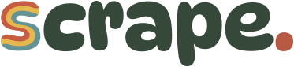
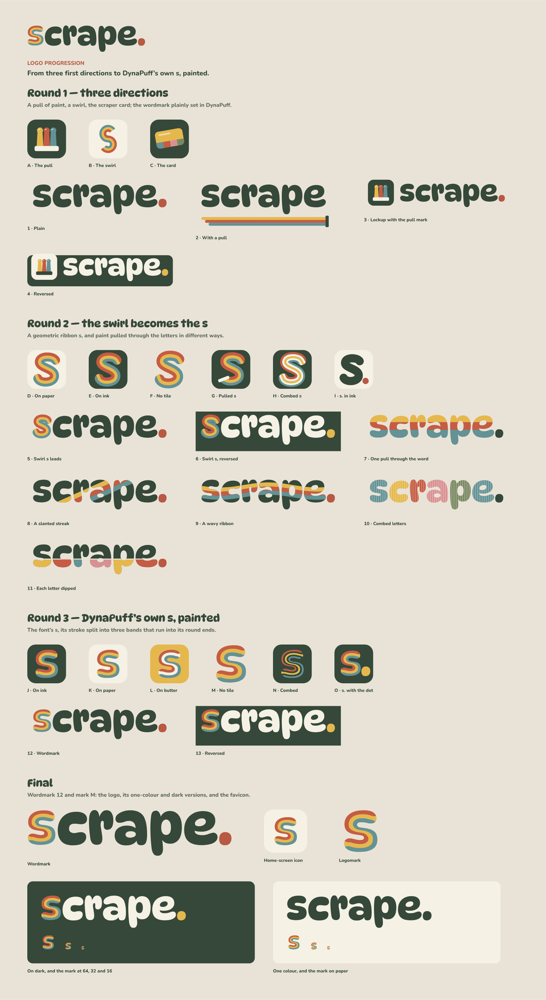
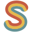
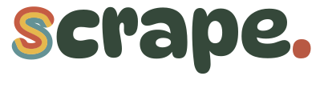
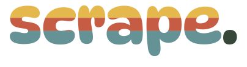
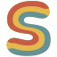
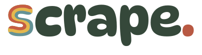
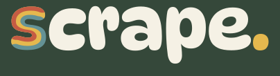

# Scrape brand

The Scrape logo is the word **scrape.** set in DynaPuff, with its **s** painted:
the letter's own stroke is split into three bands of paint, tomato, butter and
teal, that run along its curves and into its round ends, the way a card pulls
three colours across the paper. The full stop is the studio's coral.



The painted s on its own is the logomark and the favicon.


## Files

| File | Use |
| --- | --- |
| [`logo/wordmark.svg`](logo/wordmark.svg) | The logo, on light grounds |
| [`logo/wordmark-on-dark.svg`](logo/wordmark-on-dark.svg) | On dark grounds: cream letters, butter full stop |
| [`logo/wordmark-one-colour.svg`](logo/wordmark-one-colour.svg) | One-colour printing, stamps, embossing |
| [`logo/logomark.svg`](logo/logomark.svg) | The painted s on its own; also `public/favicon.svg` |
| [`logo/logomark-one-colour.svg`](logo/logomark-one-colour.svg) | The s in one colour |
| [`logo/app-icon.svg`](logo/app-icon.svg) | Home-screen icon, full bleed (the system rounds the corners) |
| [`logo/png/`](logo/png) | PNG exports of all of the above |
| [`scrape-logo-master.svg`](scrape-logo-master.svg) | Every round and the final logo on one board, for Figma |

The site uses `public/favicon.svg`, with `public/favicon.ico` (16, 32 and 48 px)
and `public/apple-touch-icon.png` (180 px) for browsers and phones that want
bitmaps. The studio and the reference page load `logo/wordmark.svg` through
`src/Wordmark.tsx`.

All letters are outlines, so nothing here needs the fonts installed. To edit in
Figma, drag `scrape-logo-master.svg` onto a file: each piece comes in as a
named group.

## Using it

- **Colours:** ink `#35483a`, tomato `#c55c43`, butter `#e5b84e`, teal
  `#649295`, coral `#b85943`, paper `#f5f1e5`, desk `#e9e3d7`.
- **Clear space:** keep at least the height of the s's top curve, about a
  quarter of the wordmark's height, clear all round.
- **Smallest size:** the wordmark stays legible down to about 24 px tall; below
  that, use the logomark. The logomark holds up at 16 px.
- **Grounds:** the full-colour logo on paper, desk or white; the on-dark version
  on ink or photographs. Don't recolour the bands, outline the letters, add
  effects or set "scrape" in another typeface beside the mark.

## How it got here

The logo came out of three rounds of exploration, all kept in
[`exploration/`](exploration) and laid out together in the master file.



### Round 1: three directions

Three ideas for a mark, each from something in the studio, and the wordmark
plainly set in DynaPuff, the studio's display face.

| | | |
| --- | --- | --- |
|  |  |  |
| **A · The pull:** three dollops pulled into ribbons and stopped by a card | **B · The swirl:** an S drawn as a three-colour ribbon | **C · The card:** the scraper card, carrying paint on its edge |

Wordmarks: [plain](exploration/round-1/1-plain.svg),
[with a pull](exploration/round-1/2-with-a-pull.svg) underneath,
[locked up](exploration/round-1/3-lockup.svg) with the pull mark, and
[reversed](exploration/round-1/4-reversed.svg).

### Round 2: the swirl becomes the s

The swirl stood out, and the idea grew that it could *be* the s of scrape. Its
ends were rounded, and it was tried on tiles, bare, pulled, combed and in one
colour. Alongside, seven ways of pulling paint through the letters themselves.

| | | | | | |
| --- | --- | --- | --- | --- | --- |
|  |  |  |  |  |  |
| D · On paper | E · On ink | F · No tile | G · Pulled | H · Combed | I · s. in ink |

 

Also: [reversed](exploration/round-2/6-swirl-s-reversed.svg),
[a slanted streak](exploration/round-2/8-a-slanted-streak.svg),
[a wavy ribbon](exploration/round-2/9-a-wavy-ribbon.svg),
[combed letters](exploration/round-2/10-combed-letters.svg) and
[each letter dipped](exploration/round-2/11-each-letter-dipped.svg).

Wordmark 5 was the one, but its geometric s, an even ribbon of perfect curves,
looked borrowed from another typeface next to DynaPuff's soft, swollen letters.

### Round 3: DynaPuff's own s, painted

Rather than draw an s to match the font, round 3 uses the font's s. Every point
inside the letter is measured for how far across the stroke it lies, and the
bands are the lines a third and two thirds of the way across. They thicken and
thin with the letter and run straight into its round ends, and the outline is
exactly DynaPuff's, so the s now belongs to "crape.".

| | | | | | |
| --- | --- | --- | --- | --- | --- |
|  |  |  |  |  |  |
| J · On ink | K · On paper | L · On butter | **M · No tile** | N · Combed | O · s. with the dot |

 

**Chosen:** wordmark 12 and mark M.

## Rebuilding

Everything above, except the PNGs, comes from
[`source/build.cjs`](source/build.cjs), which outlines the letters and paints the
s with [`source/s-bands.cjs`](source/s-bands.cjs). It needs the two fonts, both
under the SIL Open Font License, and opentype.js:

```sh
npm install --no-save opentype.js
curl -L -o /tmp/DynaPuff-SemiBold.ttf "https://fonts.gstatic.com/s/dynapuff/v9/z7N5dRvsZDIVHbYPMhZJ3HQ83UaSu4uhr7-ZFeoYkgAr1x8RS8gp6Yg.ttf"
curl -L -o /tmp/Nunito-ExtraBold.ttf "https://fonts.gstatic.com/s/nunito/v32/XRXI3I6Li01BKofiOc5wtlZ2di8HDDsmRTM.ttf"
node brand/source/build.cjs /tmp/DynaPuff-SemiBold.ttf /tmp/Nunito-ExtraBold.ttf
```

The PNGs, `public/favicon.ico` and `public/apple-touch-icon.png` were rendered
from the SVGs at their exact pixel sizes; re-export them after changing the
logo.

DynaPuff is © The DynaPuff Project Authors and Nunito © The Nunito Project
Authors, both under the [SIL Open Font License](https://openfontlicense.org),
which allows their letters, outlined, in a logo.
